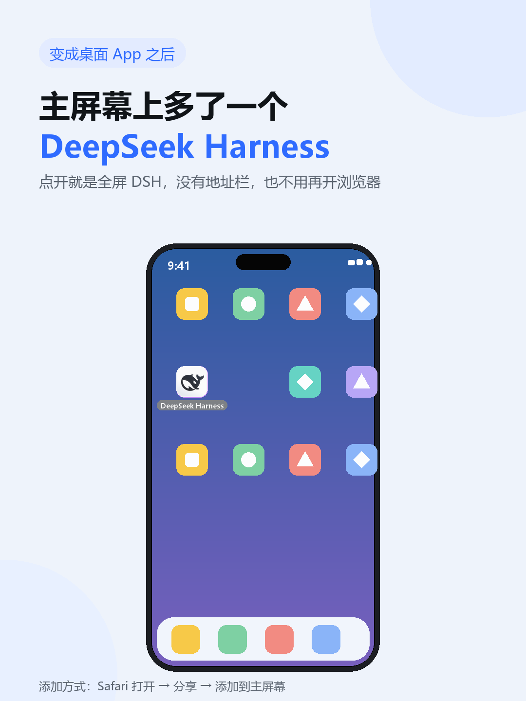

# 完整安装步骤（从零开始）

> 适用系统：Windows 10 / 11  
> 目标：在 iPhone / iPad 上远程使用电脑上的 DeepSeek Harness（DSH），并可添加到主屏幕当 App。
>
> 非官方社区项目，与 DeepSeek、Tailscale Inc. 均无关联。使用前请阅读 [第三方声明](THIRD-PARTY-NOTICES.md)。

---

## 0. 准备清单

需要准备：

- [ ] 一台 Windows 10/11 电脑
- [ ] 已在电脑上安装并登录 **DeepSeek Harness（DSH）桌面端**
- [ ] 电脑和 iPhone / iPad 都安装 **Tailscale**，并登录**同一个账号**（同一 tailnet）
- [ ] iPhone / iPad 使用 Safari

> DSH 桌面端和 Tailscale 的安装请使用各自官方安装包；本项目不提供、也不再分发它们。

---

## 1. 安装并确认 Tailscale（电脑 + 手机）

### 1.1 电脑端

1. 安装 Tailscale 并登录。
2. 打开 PowerShell，执行：

   ```powershell
   tailscale ip -4
   ```

3. 记下输出的地址，例如 `100.x.y.z`（每台电脑不同）。

> 如果提示找不到 `tailscale`：用开始菜单打开 Tailscale 一次，或把安装目录加入 PATH；也可以在后续步骤里设置 `TAILSCALE_EXE` 环境变量。

### 1.2 手机 / 平板

1. App Store 安装 Tailscale，登录**同一账号**。
2. 确认设备列表里能看到你的电脑，且状态为已连接。

### 1.3 确认互通

在电脑上执行：

```powershell
tailscale ping <手机设备名>
```

能收到 pong 即说明组网正常。

---

## 2. 获取本项目

任选一种：

- 打开 GitHub 仓库页面 → `Code` → `Download ZIP`，解压到任意目录；
- 或执行：

  ```powershell
  git clone https://github.com/Richard-He-happy/dsh-ios-gateway.git
  ```

---

## 3. 放行 Windows 防火墙（首次必做）

1. 进入解压后的目录；
2. 双击 `scripts\allow-firewall.cmd`；
3. 在 UAC 弹窗点「是」。

它会创建入站规则 **DSH iOS Gateway TCP 50108**，只放行这一个端口。

> 如果不放行，手机能连上 Tailscale，但打不开网页。

---

## 4. 启动移动网关

有两种方式，推荐方式 A。

### 方式 A：作为 DSH 插件（推荐，一劳永逸）

安装成插件后，**只要 DSH 开着，网关就自动运行**，不需要双击任何脚本，也不需要开机自启。

1. 打开 DSH；
2. 进入 **设置 → 插件管理**；
3. 安装插件，来源填：

   ```
   github:Richard-He-happy/dsh-ios-gateway
   ```

   如果插件管理页支持本地安装，也可以直接选择本项目文件夹；
4. 启用 `dsh-ios-gateway` 插件；
5. **重启一次 DSH**，让插件生效；
6. 之后每次打开 DSH，网关都会自动启动。

验证（在电脑浏览器打开）：

```
http://127.0.0.1:50108/__dsh_mobile/health
```

正常会返回一段 JSON，包含 `"upstream":{"port":...}`。

> 本插件不修改 DSH 安装包；只在你自己的 DSH profile 里增加一个插件包。插件日志在项目目录的 `gateway.log`。

#### 开发者手动安装（备用）

如果插件管理页无法直接安装 GitHub 地址，可以手动让 DSH 加载：

1. 打开 DSH profile 目录（通常是 `%USERPROFILE%\.dsh\profiles\desktop`，本项目环境为自定义 DSH_HOME）；
2. 在 `package.json` 的 `dependencies` 中加入：
   ```json
   "dsh-ios-gateway": "link:<本仓库绝对路径>"
   ```
3. 在 `dsh.profile.bundles` 数组末尾加入 `"dsh-ios-gateway"`；
4. 在 `node_modules` 下创建指向本仓库的目录链接（Windows 可用 `mklink /J`）；
5. 重启 DSH。

### 方式 B：独立脚本

1. 双击 `scripts\start-gateway.cmd`；
2. 看到 `gateway: running` 即成功；
3. 想开机自启：双击 `scripts\install-autostart.cmd`；
4. 停止：双击 `scripts\stop-gateway.cmd`。

> 插件方式和脚本方式二选一，不要同时用。插件检测到端口已被占用时会自动跳过；脚本自启动和插件同时存在会重复启动。

---

## 5. 手机 / iPad 打开

在手机 Safari 地址栏输入：

```
http://<第 1 步记下的 Tailscale IP>:50108/
```

例如：

```
http://100.x.y.z:50108/
```

**注意 `:50108` 不能省略**（否则会连到 80 端口，一直白屏）。

打开的界面与桌面端 DSH 一致，可以正常查看/切换会话、发消息。

---

## 6. 变成桌面 App（添加到主屏幕）

1. 在 Safari 中打开上面的地址；
2. 点底部**分享**按钮（方框 + 向上箭头）；
3. 选择 **添加到主屏幕** → **添加**；
4. 主屏幕上会出现官方图标的 **DeepSeek Harness**，点开即全屏，无地址栏。

效果示意：




> 如果之前添加过旧地址 / 旧图标：先删除旧图标，再用新地址重新添加一次。

---

## 7. 可选：无端口 HTTPS（更稳、更好看）

默认地址需要带 `:50108`。如果希望用 `https://<机器名>.<tailnet>.ts.net/` 这种不带端口的地址：

1. 在 Tailscale 管理后台一次性启用 **Serve** 与 **HTTPS Certificates**；
2. 双击 `scripts\setup-serve.cmd`；
3. 脚本会输出你的无端口地址，手机打开即可；
4. 添加主屏幕时也建议用这个 HTTPS 地址。

---

## 8. 验证安装成功

按顺序检查：

1. 电脑浏览器打开 `http://127.0.0.1:50108/__dsh_mobile/health` → 返回 JSON；
2. 手机 Tailscale 显示已连接；
3. 手机打开 `http://<Tailscale IP>:50108/` → 显示 DSH 界面；
4. 发一条消息，能正常返回；
5. 添加到主屏幕后，图标名称是 `DeepSeek Harness`。

全部通过即安装完成。

---

## 9. 常见问题

**手机打不开 / 白屏**

- 地址是否漏了 `:50108`？
- 手机 Tailscale 是否已连接（开关一次飞行模式重试）？
- 电脑上 `127.0.0.1:50108` 能否打开？
- 防火墙是否放行了 50108？

**`gateway: NOT running`**

- 看项目目录下的 `gateway.log`；
- 检查端口占用：`netstat -ano | findstr 50108`；
- 先 `scripts\stop-gateway.cmd` 再重新启动。

**`browser-session secret not found`**

- 先在电脑上正常打开并使用一次 DSH 桌面端；
- 检查 `DSH_HOME` 环境变量是否指向 DSH 的实际数据目录。

**插件安装后没有反应**

- 是否**重启过 DSH**？
- 打开 DSH 设置 → 插件管理，确认 `dsh-ios-gateway` 已启用；
- 打开 `http://127.0.0.1:50108/__dsh_mobile/health` 确认网关已启动。

**DSH 升级后界面样式异常**

- 本项目通过注入适配，依赖 DSH 前端类名；DSH 大版本升级后可能需要更新 `gateway/mobile.css` / `mobile.js`。

---

## 10. 卸载

**插件方式**

1. DSH 设置 → 插件管理 → 停用/卸载 `dsh-ios-gateway`；
2. 重启 DSH。

**脚本方式**

1. `scripts\uninstall-autostart.cmd`
2. `scripts\stop-gateway.cmd`

**清理防火墙规则（可选）**

管理员 PowerShell：

```powershell
netsh advfirewall firewall delete rule name="DSH iOS Gateway TCP 50108"
```

最后删除本项目文件夹即可。
