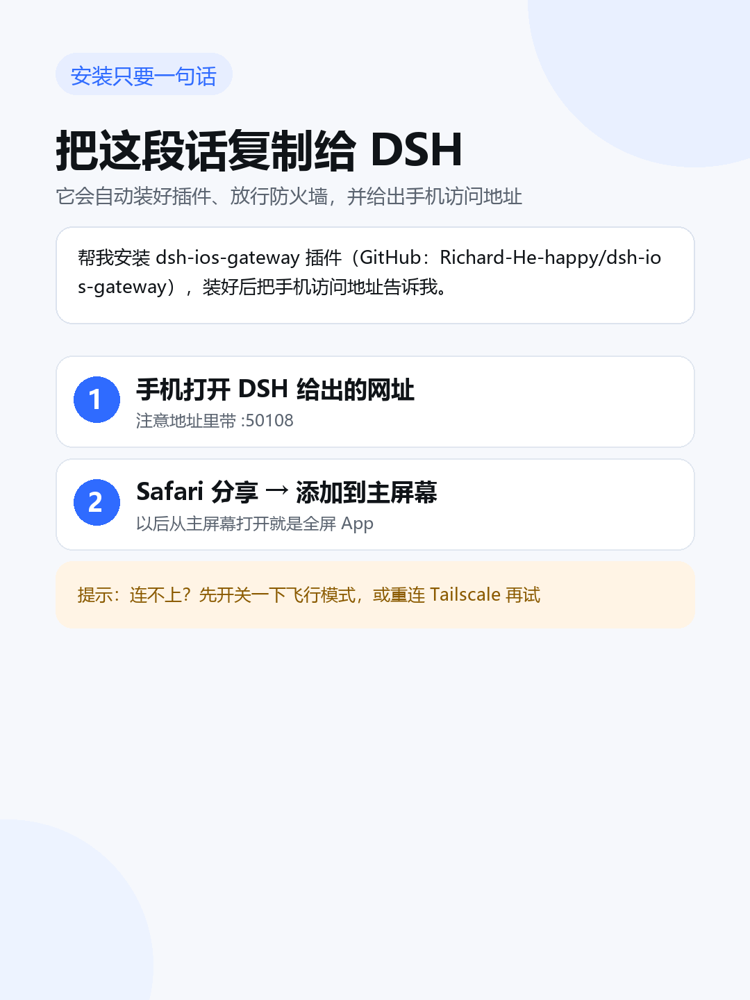

# 安装步骤

> 目标：在 iPhone / iPad 上远程使用电脑上的 DeepSeek Harness（DSH），并添加到主屏幕当 App 使用。
>
> 非官方社区项目，与 DeepSeek、Tailscale Inc. 均无关联。详见 [第三方声明](THIRD-PARTY-NOTICES.md)。

---

## 方式一（推荐）：把这段话发给 DSH

复制下面整段，直接发给你的 **DSH 对话**（需要给 DSH 完整的文件/命令权限）：

```text
帮我安装 DSH iOS Gateway（一个让 iPhone/iPad 远程使用 DSH 的开源插件）：
1. 从 GitHub 获取仓库：Richard-He-happy/dsh-ios-gateway
2. 按仓库里的 INSTALL.md，把它安装为 DSH 插件并启用
3. 放行 Windows 防火墙 TCP 50108（需要管理员权限）
4. 安装完成后，把手机访问网址和“添加到主屏幕”的步骤告诉我
5. 自检：http://127.0.0.1:50108/__dsh_mobile/health 返回正常
```

DSH 会帮你下载、安装插件、放行防火墙，并给出手机访问地址。



装好后：

1. 手机 / iPad 连上同一 Tailscale；
2. 打开 DSH 给出的网址（例如 `http://100.x.y.z:50108/`，**`:50108` 不能省**）；
3. Safari → 分享 → **添加到主屏幕** → 添加。

之后从主屏幕点开就是全屏 DSH，看不到地址栏。

> 📡 如果手机突然连不上：先**开关一下飞行模式**，或断开/重连 Tailscale，再打开网址。这是 iOS + Tailscale 的常见现象，不是安装失败（见下方 FAQ）。

---

## 方式二：手动安装

### 前置条件

- Windows 10 / 11 电脑；
- 已安装并登录 **DSH 桌面端**；
- 电脑和手机都安装 **Tailscale**，登录**同一账号**；
- 手机使用 Safari。

### 步骤

1. **下载项目**：GitHub 仓库 → `Code` → `Download ZIP`，解压到任意目录。
2. **放行防火墙**：双击 `scripts\allow-firewall.cmd`，UAC 弹窗点「是」（放行 TCP 50108）。
3. **启动网关**（二选一）：
   - **插件方式（推荐）**：DSH → 设置 → 插件管理 → 安装，来源填
     `github:Richard-He-happy/dsh-ios-gateway`，启用并重启 DSH；
     以后打开 DSH 就自动生效。
   - **脚本方式**：双击 `scripts\start-gateway.cmd`，看到 `gateway: running` 即成功；
     需要开机自启时再双击 `scripts\install-autostart.cmd`。
4. **获取电脑 Tailscale 地址**：PowerShell 执行 `tailscale ip -4`。
5. **手机打开**：`http://<电脑 Tailscale IP>:50108/`。
6. **添加到主屏幕**：Safari 分享 → 添加到主屏幕 → 添加。

> 插件方式和脚本方式二选一；插件检测到端口已被占用时会自动跳过，不会重复启动。

### 可选：无端口 HTTPS

如果不想在地址里带 `:50108`：

1. Tailscale 管理后台启用 **Serve** 与 **HTTPS Certificates**；
2. 双击 `scripts\setup-serve.cmd`；
3. 使用脚本输出的 `https://<机器名>.<tailnet>.ts.net/` 地址打开、添加到主屏幕。

---

## 验证安装成功

1. 电脑浏览器打开 `http://127.0.0.1:50108/__dsh_mobile/health`，返回 JSON 即网关正常；
2. 手机 Tailscale 已连接；
3. 手机打开 `http://<电脑 Tailscale IP>:50108/`，能看到 DSH 界面；
4. 发一条消息能正常返回；
5. 主屏幕图标名称为 `DeepSeek Harness`。

---

## 常见问题

### 手机突然连不上 / 白屏，但电脑上正常？

**先开关一次飞行模式**，或断开重连 Tailscale，再打开网址。

这是 iOS + Tailscale 的已知现象：锁屏休眠、Wi-Fi ↔ 5G 切换后，Tailscale 的数据通道可能没有及时恢复；不是本工具或安装的问题，也不是所有人都会遇到，但网络切换频繁时更容易出现。

建议：

- 手机 Tailscale 里开启 **VPN On Demand**（自动重连）；
- 出门前先确认手机 Tailscale 处于已连接状态。

参考：[Tailscale VPN On Demand](https://tailscale.com/docs/features/client/ios-vpn-on-demand)、[tailscale/tailscale#10821](https://github.com/tailscale/tailscale/issues/10821)。

### 地址打不开 / 一直白屏

- 检查地址是否**漏了 `:50108`**（漏了会连到 80 端口，一直白屏）；
- 手机 Tailscale 是否已连接；
- 电脑上 `http://127.0.0.1:50108/__dsh_mobile/health` 是否正常；
- 防火墙是否放行了 50108。

### `gateway: NOT running`

- 查看项目目录下的 `gateway.log`；
- 检查端口占用：`netstat -ano | findstr 50108`；
- 先运行 `scripts\stop-gateway.cmd` 再重新启动。

### `browser-session secret not found`

- 先在电脑上正常打开并使用一次 DSH 桌面端；
- 检查 `DSH_HOME` 是否指向 DSH 的实际数据目录。

### 插件安装后没反应

- 是否**重启过 DSH**？
- DSH 设置 → 插件管理，确认 `dsh-ios-gateway` 已启用；
- 打开 `http://127.0.0.1:50108/__dsh_mobile/health` 确认网关已启动。

### DSH 升级后界面样式异常

本项目通过注入适配，依赖 DSH 前端类名；DSH 大版本升级后可能需要更新 `gateway/mobile.css` / `mobile.js`。

---

## 卸载

**插件方式**：DSH 设置 → 插件管理 → 停用/卸载 `dsh-ios-gateway`，重启 DSH。

**脚本方式**：`scripts\uninstall-autostart.cmd` + `scripts\stop-gateway.cmd`。

**清理防火墙规则（可选，管理员 PowerShell）**：

```powershell
netsh advfirewall firewall delete rule name="DSH iOS Gateway TCP 50108"
```

最后删除项目文件夹即可。
