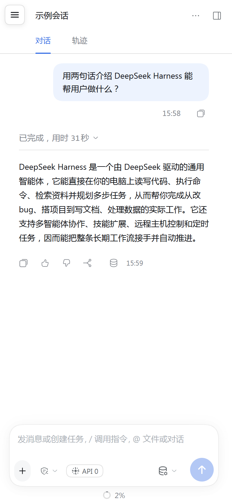
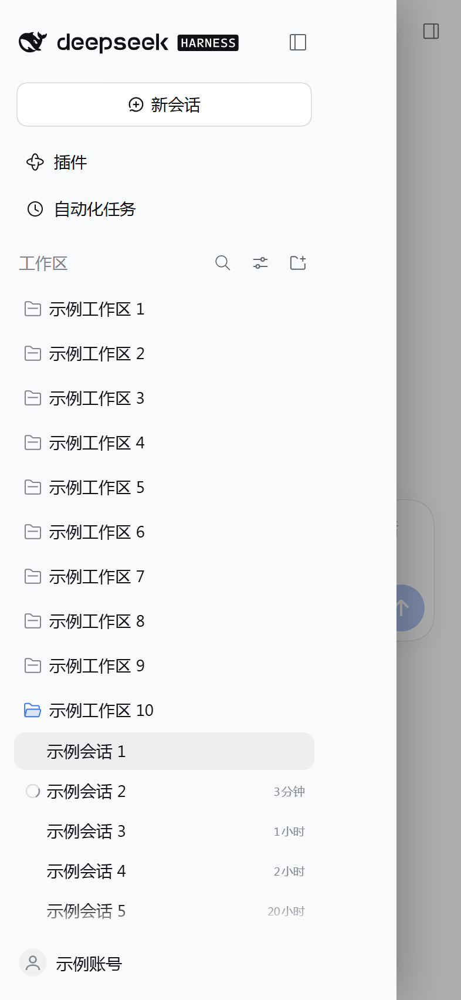
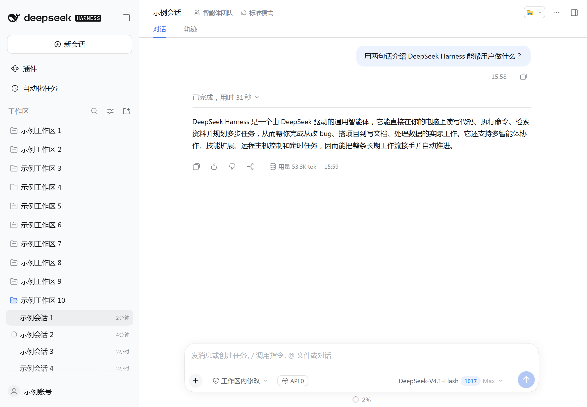
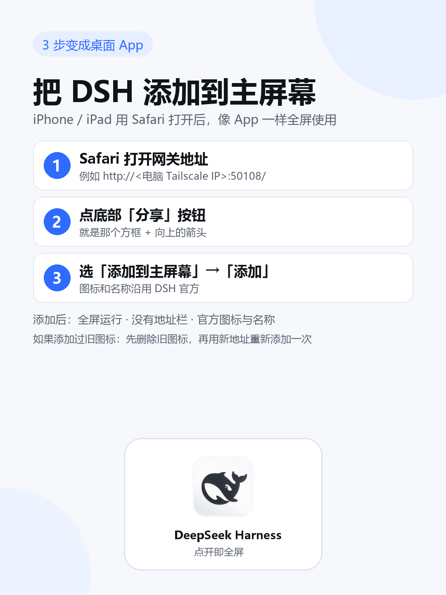

# DSH iOS Gateway

> 用 **iPhone / iPad** 远程使用 **DeepSeek Harness（DSH）** 桌面端 —— 通过 Tailscale 加密组网，把仅监听本机回环地址的 DSH Web GUI 暴露给 iOS 设备，并自动注入移动端布局适配。

**不修改 DSH 安装包、不需要重启 DSH、iOS 端不需要登录或输入令牌。**

> ⚠️ 非官方社区项目：与 **DeepSeek**、**Tailscale Inc.** 均无关联。Tailscale 仅作为可选传输层，需自行安装并遵守其条款；详见 [第三方声明](THIRD-PARTY-NOTICES.md)。



| 手机侧边栏（抽屉） | iPad 横屏 |
|---|---|
|  |  |

---

## 核心卖点

- 🖥️ **完整保留电脑端 DSH 的原生工作区与会话体验**：同一套工作区、会话历史、文件、终端、预览、模型与工具；手机/平板只是这台电脑的“第二块屏幕”，不是精简版、也不是独立的新服务。
- 🌍 **不需要局域网、不需要同一 Wi-Fi**：iPhone / iPad 在 5G、公司网络、酒店 Wi-Fi 下都能直连家里的电脑；**不需要公网 IP、端口映射、DDNS，也不需要 frp / ngrok 之类内网穿透**。
- 🔐 **端到端加密 + 零登录**：流量走 Tailscale（WireGuard）加密隧道；网关用本机 secret 现场签发会话 cookie，iOS 端无需输入令牌或账号，secret 不离开电脑。
- 🔄 **DSH 重启自动跟随**：DSH 每次启动的随机回环端口会被自动发现，电脑重启、DSH 升级后都不用改任何配置。
- ⚡ **完整 WebSocket 实时体验**：流式输出、工具调用状态、长任务进度与桌面端实时同步，不会“刷新才更新”。
- 📱 **为 iPhone / iPad 深度适配**：抽屉式侧边栏、设置单列、右侧栏全屏、16px 防聚焦缩放、安全区与软键盘、回车换行、会话单击切换、切换后不弹键盘。
- 🏠 **主屏幕 App（PWA）**：使用 DSH 官方图标与名称，全屏使用；可选无端口 HTTPS（Tailscale Serve 自动签发证书）。
- 🧩 **零侵入、轻量**：不修改 DSH 安装包、不重启 DSH；单个 Node 脚本，无数据库、无第三方服务，MIT 开源。
- ♻️ **多设备同时在线**：iPhone、iPad 可同时连接同一实例，随时切回电脑继续同一个会话。
- 🛡️ **访问可控**：只监听 Tailscale 地址与回环地址，不暴露公网；通过 tailnet 设备管理与 ACL 随时撤销某台设备。

---

## 功能特性

- 📱 **手机/平板直接操控 DSH**：与桌面端同一套界面、会话、模型和工具，不是独立服务。
- 🔐 **自动认证**：网关用本机 DSH 的 `browser-session` secret 现场签发会话 cookie，手机端无需登录，launch token 也不会离开电脑。
- 🔄 **自动发现上游**：DSH 的回环端口每次启动都会变化，网关自动发现并跟随；DSH 重启后手机只需刷新。
- 🔌 **完整 WebSocket 代理**：会话流式输出、实时工具状态都能正常显示。
- 📐 **移动端适配**（注入式，不改 DSH 安装）：
  - 左侧图标栏默认隐藏，左上角悬浮 ☰ 打开抽屉式侧边栏；
  - 设置页单列、右侧栏全屏、输入框 16px（避免 iOS 聚焦缩放）；
  - 适配刘海/灵动岛/Home 指示条与软键盘；
  - 手机/平板**回车 = 换行**，蓝色按钮发送；
  - **会话单击即切换**；切换后默认不弹键盘，点输入框才弹。
- 🖥️ **PWA**：可“添加到主屏幕”，使用 DSH 官方图标与名称，全屏 App 体验。
- 🌐 **可选无端口入口**：用 Tailscale Serve 提供 `https://<你的机器>.<tailnet>.ts.net/`（自动签发证书）。
- ♻️ **开机自启动**：安装到当前用户 Startup 文件夹，无需管理员权限（放行防火墙除外）。

---

## 工作原理（简述）

DSH 桌面端的 Web GUI 默认只监听 `127.0.0.1` 的随机端口，并有 Host 头校验 + browser-session cookie 两层远程防护。

本网关做三件事：

1. 监听本机 **Tailscale IPv4:50108**（以及回环地址，供 Tailscale Serve 使用），绝不监听 `0.0.0.0`；
2. 把请求的 `Host` / `Origin` 改写为 DSH 的回环地址，并注入由本机 secret 现场签发的会话 cookie，再反向代理到 DSH；
3. 对 HTML 注入移动端 CSS/JS 与 PWA 元信息；对 WebSocket 直接 TCP 透传。

> secret 只在内存中读取，不写日志、不发往手机；所有流量都走 Tailscale 加密的 tailnet。

---

## 环境要求

| 组件 | 要求 |
|---|---|
| 电脑 | Windows 10 / 11（脚本为 `.cmd` / `.vbs`；核心网关是 Node 脚本，也可在其他系统手动运行） |
| DSH | DeepSeek Harness 桌面端（Windows），已正常登录并使用过 |
| Node.js | 18+（脚本会自动查找 DSH 自带的 Node，找不到则用 `PATH` 中的 `node`） |
| 组网 | 电脑与手机/平板安装 Tailscale 并登录**同一 tailnet** |
| 手机/平板 | iOS / iPadOS 15+ 的 Safari（其他现代浏览器亦可） |

---

## 安装（Windows）

1. **下载**本仓库（Code → Download ZIP，或 `git clone`）并解压到任意目录。
2. **（推荐）放行防火墙**：双击 `scripts\allow-firewall.cmd`，在 UAC 弹窗点「是」。
   - 放行入站 TCP `50108`，仅 Tailscale 设备可访问。
3. **启动网关**：双击 `scripts\start-gateway.cmd`，看到 `gateway: running` 即成功。
4. **获取电脑的 Tailscale 地址**：`tailscale ip -4`，例如 `100.x.y.z`。
5. **手机/平板打开**：`http://100.x.y.z:50108/`
6. **（可选）添加到主屏幕**：Safari → 分享 → 添加到主屏幕。之后就像 App 一样全屏使用。
7. **（可选）开机自启**：双击 `scripts\install-autostart.cmd`。
8. **（可选）无端口 HTTPS**：双击 `scripts\setup-serve.cmd`，得到 `https://<机器名>.<tailnet>.ts.net/`。
   - 需在 Tailscale 管理后台一次性启用 **Serve** 与 **HTTPS Certificates**（DNS 页面）。

---

## 变成桌面 App（添加到主屏幕）

iPhone / iPad 用 Safari 打开网关地址后，可以像原生 App 一样全屏使用，无需安装任何 App：

1. Safari 打开网关地址（例如 `http://100.x.y.z:50108/`）；
2. 点底部「分享」按钮（方框 + 向上箭头）；
3. 选择「添加到主屏幕」→「添加」。



- 图标与名称沿用 **DSH 官方**（DeepSeek Harness）；
- 添加后全屏运行，没有地址栏，和普通 App 一样从主屏幕打开；
- 建议使用 HTTPS（`setup-serve.cmd` 生成的 `https://<机器名>.<tailnet>.ts.net/`）地址添加，体验最佳；
- 如果之前添加过旧地址 / 旧图标：先删除旧图标，再用新地址重新添加一次；
- 主屏幕 App 与 Safari 共用网关的自动认证，不需要重复登录。

---

## 配置项（环境变量）

| 变量 | 默认值 | 说明 |
|---|---|---|
| `DSH_MOBILE_HOST` | 自动检测 | 网关监听的地址；默认取 `tailscale ip -4` |
| `DSH_MOBILE_PORT` | `50108` | 网关监听端口 |
| `DSH_MOBILE_LOOPBACK` | `1` | 是否同时监听 `127.0.0.1`（给 Tailscale Serve 用） |
| `DSH_UPSTREAM_PORT` | 自动发现 | 固定 DSH Web 端口（一般不需要） |
| `DSH_HOME` | `%USERPROFILE%\.dsh` | DSH 数据目录（secret 所在） |
| `DSH_CREDENTIALS` | `$DSH_HOME\.credentials.yaml` | 凭据文件路径 |
| `DSH_NODE` | 自动查找 | 指定 `node.exe` 路径（脚本用） |
| `TAILSCALE_EXE` | 自动查找 | 指定 `tailscale.exe` 路径 |

> 如果 DSH 数据目录不是默认位置，请先把 `DSH_HOME` 设置为实际路径（例如 `setx DSH_HOME "D:\DSH\.dsh"`），再启动网关。

---

## 文件结构

```
dsh-ios-gateway/
├─ gateway/
│  ├─ mobile-gateway.cjs     # 网关：认证 / 反代 / 注入 / 自动发现
│  ├─ mint-cookie.cjs        # 从本机 secret 签发 DSH 会话 cookie
│  ├─ mobile.js              # 移动端交互适配
│  ├─ mobile.css             # 移动端布局适配
│  ├─ manifest.webmanifest   # PWA manifest
│  └─ icon-*.png / apple-touch-icon-harness.png
├─ scripts/
│  ├─ start-gateway.cmd / start-gateway.vbs
│  ├─ stop-gateway.cmd / status-gateway.cmd
│  ├─ install-autostart.cmd / uninstall-autostart.cmd
│  ├─ allow-firewall.cmd
│  └─ setup-serve.cmd
├─ docs/                     # 截图与示意图
├─ THIRD-PARTY-NOTICES.md    # 第三方软件与商标声明
└─ LICENSE                   # MIT（仅覆盖本项目代码）
```

---

## 常见问题

**打不开 / 白屏**
1. 先确认手机上的 Tailscale 显示已连接（可开关一次飞行模式重连）；
2. 确认地址端口没丢：`http://<IP>:50108/`，`50108` 不能省略；
3. 在电脑上打开 `http://127.0.0.1:50108/__dsh_mobile/health`，正常应返回一段 JSON；
4. iOS 主屏幕 App 可能是旧缓存：从后台彻底关闭再打开，或删除图标重新添加。

**`browser-session secret not found`**
DSH 还没有可用的浏览器会话凭据。先在电脑上正常打开并使用一次 DSH 桌面端，再启动网关；或检查 `DSH_HOME` 是否指向正确的数据目录。

**`gateway: NOT running`**
查看 `gateway\gateway.log`；检查端口占用：`netstat -ano | findstr 50108`；也可用 `scripts\stop-gateway.cmd` 清理后重试。

**DSH 升级后样式错乱**
本项目通过注入适配，依赖 DSH 前端的类名；DSH 大版本升级后可能需要更新 `mobile.css` / `mobile.js`。网关核心（认证/反代）通常不受影响。

**主屏幕 App 底部有空白**
iOS 对 `black-translucent` 状态栏的视口计算问题；删除图标、重新“添加到主屏幕”通常可消除，或直接使用 Safari。

**键盘上方的 ↑ ↓ ✓ 栏**
这是 iOS 系统输入辅助栏，网页无法去除。

**想换端口**
设置 `DSH_MOBILE_PORT`（例如 `setx DSH_MOBILE_PORT 50109`），然后重新运行 `allow-firewall.cmd` 和 `start-gateway.cmd`。

---

## 安全说明

- 网关默认只监听 **Tailscale 地址**与回环地址，不会暴露到局域网/公网；
- 请勿修改为 `0.0.0.0`，也不要用 Tailscale Funnel 把它发布到公网；
- 手机端不保存 DSH 的 secret；cookie 由电脑本地签发；
- 访问控制依赖你的 tailnet：**任何能加入你 tailnet 的设备都能打开该界面**，请管理好 tailnet 成员与 ACL。

---

## 卸载

1. `scripts\uninstall-autostart.cmd`（移除开机自启）
2. `scripts\stop-gateway.cmd`（停止网关）
3. 删除防火墙规则（可选）：管理员 PowerShell 执行
   `netsh advfirewall firewall delete rule name="DSH iOS Gateway TCP 50108"`
4. 删除本文件夹。

---

## 免责声明与第三方声明

- 本项目是**非官方**社区工具，**与 DeepSeek、Tailscale Inc. 均无关联**，也未获得其背书或赞助；
- **Tailscale** 仅作为可选的网络传输方式：本项目不包含、不修改、不再分发任何 Tailscale 代码，只调用用户自行安装的 Tailscale CLI（`tailscale ip` / `tailscale serve`）。使用 Tailscale 需遵守其自身服务条款与开源许可；
- “Tailscale”“DeepSeek”“DeepSeek Harness”等名称与图标归各自权利人所有，本项目仅在描述用途与标识用户本机应用时使用；
- 本项目依赖 DSH 桌面端的内部实现（浏览器会话 cookie、回环端口、Host 校验），DSH 升级后可能失效；
- MIT 许可仅适用于本仓库自身代码，不覆盖任何第三方软件、名称或商标；详见 [THIRD-PARTY-NOTICES.md](THIRD-PARTY-NOTICES.md)；
- 使用风险自负，请自行评估数据与访问安全。若权利人认为本项目中的名称/图标使用不当，欢迎提 issue，我们会及时调整。

## License

[MIT](LICENSE)
